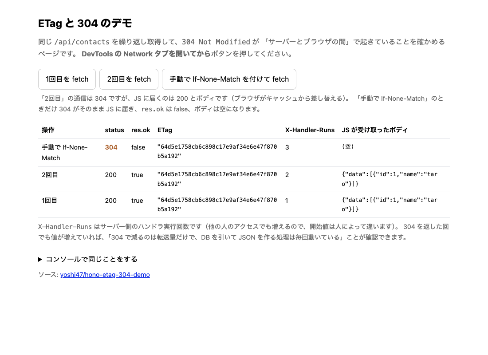

# hono-etag-304-demo

`ETag` と `If-None-Match` で 304 が返る流れを、ブラウザの DevTools で見るためのデモです。Hono の [etag ミドルウェア](https://hono.dev/docs/middleware/builtin/etag) を Cloudflare Workers で動かしています。

https://hono-etag-304-demo.yoshi47.workers.dev/



Network タブを開いてボタンを押すと、2回目の通信は 304 なのに JS に届くのは 200 とボディ、というのが見られます。自分で `If-None-Match` を付けたときだけ、304 がそのまま JS に届きます。

アプリ本体は `src/app.js`、画面は `src/page.js`、Node で動かすときのランチャーは `server.mjs` です。

## 動かす

```bash
npm install
npm run dev     # wrangler dev → http://localhost:8787
npm start       # node server.mjs → http://localhost:8787
```

デプロイは `npm run deploy` です。`wrangler.jsonc` の `name` がそのままURLになります。

記事: https://zenn.dev/yoshi47/articles/etag-304-hono-devtools
